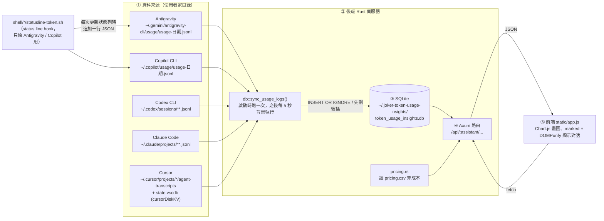
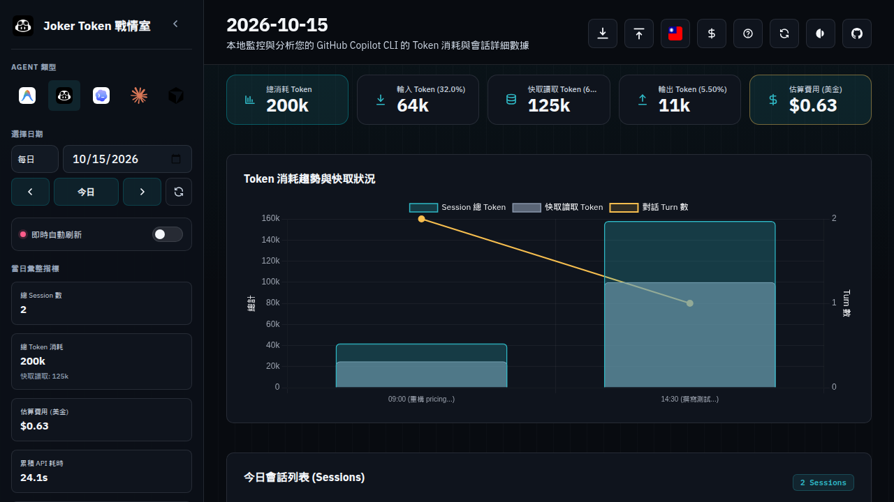

# 逆向分析「Joker Token 戰情室」學習報告

> 這份報告是學習練習：用一套逆向分析命令列工具（下文以 `$RE_CLI` 代稱）去「從成品反推」[jokersosmart/joker_TokenUsageInsights](https://github.com/jokersosmart/joker_TokenUsageInsights) 的架構，再拿原始碼逐一對照，看看逆向分析哪些看對、哪些漏掉、哪些看錯。
> 最後整理出「如果要自己重做一個，最少需要哪些零件」。
>
> 本報告中所有逆向分析輸出都是在雲端 VM（Ubuntu 24.04、x86-64、4 核心 CPU）上實際執行的結果，原始 JSON 放在 [`raw/`](raw/) 目錄。所有執行期分析都使用**假資料**（`/tmp/fixture`），沒有讀取任何真實的 AI 使用紀錄。`raw/` 中的工具識別字串（provider 名稱、版本欄位、環境變數前綴等）已改為中性名稱，因此這些檔案的內容與原始輸出並非逐位元組相同。

## 目錄

1. [先備知識：這個專案在做什麼](#1-先備知識這個專案在做什麼)
2. [架構總覽與資料流](#2-架構總覽與資料流)
3. [主要模組](#3-主要模組)
4. [API 端點](#4-api-端點)
5. [成本是怎麼估算的](#5-成本是怎麼估算的)
6. [實際執行的逆向分析指令與輸出摘錄](#6-實際執行的逆向分析指令與輸出摘錄)
7. [逆向分析結果和原始碼的對照](#7-逆向分析結果和原始碼的對照)
8. [限制與注意事項](#8-限制與注意事項)
9. [若要自己重做一個，最小可行版本需要哪些部件](#9-若要自己重做一個最小可行版本需要哪些部件)
10. [附錄：如何重現本報告](#10-附錄如何重現本報告)

---

## 1. 先備知識：這個專案在做什麼

「Joker Token 戰情室」是一個**只在本機執行**的儀表板，用來統計 5 種 AI 程式助理（Antigravity、GitHub Copilot CLI、Codex CLI、Claude Code、Cursor）用掉了多少 token、大約花了多少錢。

它由兩個部分組成：

| 部分 | 技術 | 位置 |
| --- | --- | --- |
| 後端伺服器 | Rust + [Axum](https://github.com/tokio-rs/axum)（網頁框架）+ [rusqlite](https://github.com/rusqlite/rusqlite)（SQLite） | `src/` |
| 前端網頁 | 純 HTML / JavaScript / CSS，沒有用 React 之類的框架 | `static/` |

編譯後會得到兩個執行檔：

- `target/release/joker-token-usage-insights`：儀表板伺服器（約 5.9 MB）
- `target/release/joker-token-usage-insights-cli`：匯入 / 匯出某一天資料的命令列小工具（約 2.7 MB）

---

## 2. 架構總覽與資料流

一句話：**讀取各家 AI 工具留在硬碟上的紀錄檔 → 增量寫進一個 SQLite 資料庫 → 用 HTTP API 提供統計結果 → 網頁畫成圖表**。



### 一步一步看

1. **資料來源**：每家工具留下的紀錄格式都不一樣。
   - Antigravity 和 Copilot 本身沒有提供用量紀錄，所以專案附了 `shell/antigravity/statusline-token.sh`、`shell/copilot/statusline-token.sh`。它們被設定成工具的「狀態列指令」，每次被呼叫時把 token 數字追加到 `usage/usage-YYYY-MM-DD.jsonl`。
   - Codex、Claude Code、Cursor 則是**直接解析它們自己的對話紀錄檔**（transcript）。Cursor 還會額外讀它的 `state.vscdb` SQLite 資料庫（`cursorDiskKV` 表）來補模型名稱與工作目錄。
2. **同步**（`src/db.rs` 的 `sync_usage_logs`）：依序同步 5 種助理。為了不要每次都重讀整個檔案，它用 `sync_state` 表記住「每個檔案已經讀到第幾個 byte」，下次只讀新增的部分（增量同步）。
3. **SQLite**：所有助理的資料都寫到同一張 `usage_entries` 表，用 `assistant_type` 欄位區分。唯一索引 `(assistant_type, session_id, turn_no)` 避免同一輪對話被重複寫入。
4. **API**：前端呼叫 `/api/copilot/usage/2026-10-15` 這類網址，後端從 SQLite 查出資料、彙總每個 session、算出成本後回傳 JSON。
5. **前端**：`static/app.js`（約 4,800 行）負責所有畫面：日 / 月 / 年報表、session 時間軸、匯入匯出、即時刷新等。

---

## 3. 主要模組

| 檔案 | 行數 | 職責 |
| --- | ---: | --- |
| `src/main.rs` | 195 | 啟動流程：初始化資料庫 → 遷移舊資料庫 → 第一次同步 → 開背景同步任務（每 5 秒）→ 註冊路由 → 監聽 `0.0.0.0:3003` |
| `src/db.rs` | 4,425 | 專案的核心。資料目錄解析、建表、5 種助理的解析與增量同步、各種查詢（依日 / 月 / 年）、匯入匯出 |
| `src/pricing.rs` | 182 | 讀 `pricing.csv`、模型名稱比對、算成本 |
| `src/timeline.rs` | 1,338 | 把各家 transcript 轉成統一的「對話時間軸」（使用者訊息、AI 回覆、工具呼叫） |
| `src/paths.rs` | 103 | 環境變數路徑（支援 `~` 展開）、尋找 `static/` 和 `pricing.csv` 的位置 |
| `src/handlers/*.rs` | ~2,500 | HTTP 處理函式（日 / 月 / 年 / 其他） |
| `src/bin/joker-token-usage-insights-cli.rs` | 461 | CLI：`export` / `import` 某一天的資料（直接 `#[path]` 引用 `db.rs`、`paths.rs`） |
| `static/app.js` | 4,773 | 前端主程式 |
| `static/i18n.js` | 669 | 中英文翻譯字串（`export default i18n`） |
| `pricing.csv` | 123 | 模型價格表（每百萬 token 的美金價格） |

### SQLite 資料表（`db::init_db`）

| 資料表 | 用途 |
| --- | --- |
| `usage_entries` | 每一輪對話一列：時間、session、模型、累計 token（`tokens_*`）與本輪增量 token（`delta_*`）等 32 個欄位 |
| `sync_state` | 增量同步的書籤：`filename → last_synced_size`；也拿來記錄「某個資料遷移已經做過了」 |
| `cursor_model_signatures` | Cursor 專用：用工具呼叫特徵對應到實際模型名稱 |
| `cursor_session_metadata` | Cursor 專用：session 的工作目錄與模式（agent / ide） |

---

## 4. API 端點

全部定義在 `src/main.rs`。`:assistant` 可以是 `antigravity`、`copilot`、`codex`、`claude`（也接受 `claude-code`）、`cursor`，其他值會回 400。

| 方法 | 路徑 | 處理函式 | 作用 |
| --- | --- | --- | --- |
| GET | `/api/:assistant/dates` | `daily::get_available_dates` | 有資料的日期清單 |
| GET | `/api/:assistant/setup-info` | `daily::get_setup_info` | 各助理的資料目錄、hook 腳本位置、是否已安裝 |
| GET | `/api/:assistant/usage/:date` | `daily::get_usage_details` | 某天的總計、每個 session 彙總、原始紀錄 |
| GET | `/api/:assistant/usage/:date/export` | `misc::export_usage_day` | 匯出某天資料為 JSON |
| POST | `/api/:assistant/usage/:date/import` | `misc::import_usage_day` | 匯入 JSON（上限 200 MB，以 `import_source_id` 去重） |
| GET | `/api/:assistant/session/:session_id` | `daily::get_session_details` | 單一 session 的對話時間軸（`timeline.rs`） |
| GET | `/api/:assistant/months` | `monthly::get_available_months` | 有資料的月份 |
| GET | `/api/:assistant/monthly/:year_month` | `monthly::get_monthly_details` | 月報：每日明細、專案、模型 |
| GET | `/api/:assistant/years` | `yearly::get_available_years` | 有資料的年份 |
| GET | `/api/:assistant/yearly/:year` | `yearly::get_yearly_details` | 年報 |
| GET | `/api/:assistant/pricing` | `misc::get_pricing` | 回傳 `pricing.csv` 內容 |
| GET | `/api/:assistant/sync` | `misc::trigger_manual_sync` | 手動觸發一次同步 |
| GET | `/api/:assistant/rate-limit` | `misc::get_rate_limit` | 只支援 `codex`：最新的 rate limit 資訊 |
| GET | `/static/*`、其他路徑 | `ServeDir` | 提供 `static/` 目錄的檔案（`/` 會回 `index.html`） |

CORS 預設只允許 `http://localhost:<PORT>` 與 `http://127.0.0.1:<PORT>`，可用 `CORS_ALLOWED_ORIGINS` 覆蓋。注意伺服器綁定的是 `0.0.0.0`，所以同一個網路裡的其他電腦也連得到。

---

## 5. 成本是怎麼估算的

核心在 `src/pricing.rs` 的 `calculate_cost`，由 `handlers/daily.rs`、`monthly.rs`、`yearly.rs` 在**每次 API 請求時**呼叫（每次都會重新讀一次 `pricing.csv`，所以改價格不用重啟）。

### 步驟

1. **把一個 session 的 token 加總**：把該 session 每一輪的 `delta_*`（本輪增量）加起來，得到 input、output、cache_read。若增量全部是 0，就改用最後一輪的累計值 `tokens_*`。
2. **決定模型**：`select_session_model` 取這個 session 中**最後一個具體的模型名稱**（排除 `Cursor Agent`、`Cursor IDE`、`Unknown Model`）。整個 session 都用這個模型計價。
3. **找價格規則**：
   - 把模型名稱轉小寫、只留英數字（`Claude Sonnet 4.6` → `claudesonnet46`）。
   - 有些模型分長短上下文兩種價格，CSV 裡寫成 `GPT-5.5 (<272k)` / `GPT-5.5 (>272k)`。程式用 `input + cache_read + output > 272,000` 判斷是否為長上下文。
   - 先找**名稱完全相同**的規則；找不到再找**名稱互相包含**的規則（依 CSV 順序取第一個）。
4. **計算**：

\[
\text{成本} = \frac{\text{input}}{10^6} \times \text{輸入價} + \frac{\text{cache\_read}}{10^6} \times \text{快取輸入價} + \frac{\text{output}}{10^6} \times \text{輸出價}
\]

5. 找不到規則時印出警告並以 **0 元**計算。

### 用假資料驗證

我準備了兩個 Copilot session（見第 6.4 節），手算結果如下，和伺服器 API 實際回傳的值完全一致：

| Session | 模型 | input | cache_read | output | 套用的規則 | 手算 | API 回傳 `cost_usd` |
| --- | --- | ---: | ---: | ---: | --- | ---: | ---: |
| demo-session-a | Claude Sonnet 4.6 | 14,000 | 25,000 | 3,000 | `Claude Sonnet 4.6`（3.00 / 0.30 / 15.00） | 0.042 + 0.0075 + 0.045 = **0.0945** | `0.0945` |
| demo-session-b | GPT-5.5 | 50,000 | 100,000 | 8,000 | `GPT-5.5 (<272k)`（5.00 / 0.50 / 30.00），因為總量 158k < 272k | 0.25 + 0.05 + 0.24 = **0.54** | `0.54` |
| 合計 | | | | | | **0.6345** | `0.6345000000000001` |

（合計後面的 `...0001` 是浮點數誤差，不是 bug。）

### 值得注意的設計取捨

- `cache_write`（寫入快取）的 token 有被記錄、也會顯示，但**不計入成本**。
- 一個 session 若中途換了模型，全部 token 都用最後那個模型的價格計算。
- 「名稱互相包含」的模糊比對依賴 CSV 的排列順序，新增價格時要留意順序。
- 這是**估算值**，不是帳單金額（例如 Copilot 訂閱制本身並不按 token 收費）。

---

## 6. 實際執行的逆向分析指令與輸出摘錄

### 6.1 安裝

VM 預設的 Node 是 22.14，低於該逆向分析工具要求的 22.19+，所以改用 nvm 裝好的 Node 24，再依該工具文件安裝其命令列程式，並以 `RE_CLI` 環境變數指向它：

```bash
export PATH=$HOME/.nvm/versions/node/v24.22.0/bin:$PATH
# 依工具文件安裝逆向分析 CLI 後：
export RE_CLI=/path/to/reverse-analysis-cli
$RE_CLI --version
$RE_CLI doctor
```

`$RE_CLI doctor` 一開始回報 `healthy: false`，因為沒有安裝任何原生分析引擎（Hopper / Ghidra / IDA / jadx）。之後我另外下載 Ghidra 12.1.4（工具文件指定 12.1.x）並使用 VM 內建的 OpenJDK 21：

```bash
export GHIDRA_INSTALL_DIR=/opt/ghidra/ghidra_12.1.4_PUBLIC
$RE_CLI doctor --provider ghidra --json
```

實際輸出（節錄）：

```json
{"healthy":true,"scope_checks":[
  {"name":"ghidra-version","ok":true,"detail":"12.1.4"},
  {"name":"ghidra-headless","ok":true,"detail":"/opt/ghidra/ghidra_12.1.4_PUBLIC/support/analyzeHeadless"},
  {"name":"ghidra-native_decompiler","ok":true,"detail":".../decompile reports elf x86_64, which matches linux/x64"},
  {"name":"ghidra-java","ok":true,"detail":"21.0.12.1; 64-bit; JDK; /usr/lib/jvm/java-21-openjdk-amd64; accepted a 64-bit full JDK 21 or newer"}]}
```

### 6.2 前端：JavaScript 應用程式靜態分析

```bash
$RE_CLI analyze-javascript-application /workspace/static --json > js-app.json
# 完整 Evidence 有 25 MB，依文件建議投影成摘要
jq -c '{source: {kind: "inline", evidence: .}, view: {kind: "summary"}}' js-app.json > view-summary.json
$RE_CLI inspect-analysis-view view-summary.json --json > js-summary.json
```

執行約 6.4 秒。摘要中的統計（[`raw/js-app-summary-view.json`](raw/js-app-summary-view.json)）：

```json
"statistics": {
  "relevant_files": 3,
  "text_bytes_read": 285156,
  "parsed_javascript_files": 2,
  "visited_ast_nodes": 23398,
  "findings": 17,
  "modules": 0,
  "parse_failures": 0
}
```

工具自己列出的重要限制（原文）：

> `index.html has 1 inline JavaScript body starting at line 18 that was not analyzed; endpoints, storage, imports and other facts in it are absent from the evidence.`

我從 25 MB 的完整 Evidence 中，用 `jq` 擷取了 request、timer、storage 等節點（[`raw/js-app-extract.json`](raw/js-app-extract.json)）。逆向分析工具找到的 13 個 `fetch` 呼叫：

```json
{"line":948,"label":"fetch","properties":{"endpoint":null,"method":"fetch","operation_kind":"request"},"enclosing_function":null}
{"line":1302,"label":"fetch","properties":{"endpoint":null,...},"enclosing_function":"refreshLiveData"}
{"line":1336,"label":"fetch",...,"enclosing_function":"fetchDates"}
{"line":1405,"label":"fetch",...,"enclosing_function":"loadUsageData"}
{"line":1441,"label":"fetch",...,"enclosing_function":"exportCurrentUsageDay"}
{"line":1514,"label":"fetch",...,"enclosing_function":"importUsageDayFromFile"}
{"line":2421,"label":"fetch",...,"enclosing_function":"openSessionTimeline"}
{"line":2985,"label":"fetch",...,"enclosing_function":"fetchMonths"}
{"line":3041,"label":"fetch",...,"enclosing_function":"fetchYears"}
{"line":3106,"label":"fetch",...,"enclosing_function":"loadYearlyData"}
{"line":3747,"label":"fetch",...,"enclosing_function":"loadMonthlyData"}
{"line":4383,"label":"fetch",...,"enclosing_function":"loadSetupInfo"}
{"line":4658,"label":"fetch",...,"enclosing_function":"fetchPricingRules"}
```

計時器：

```json
{"line":1267,"label":"setInterval","properties":{"delay_milliseconds":100},"enclosing_function":"startLiveRefresh"}
{"line":1277,"label":"setInterval","properties":{"delay_milliseconds":null},"enclosing_function":"startLiveRefresh"}
{"line":2729,"label":"setTimeout","properties":{"delay_milliseconds":2000},"enclosing_function":null}
{"line":4229,"label":"setTimeout","properties":{"delay_milliseconds":3000},"enclosing_function":"showNotification"}
{"line":4551,"label":"setTimeout","properties":{"delay_milliseconds":2000},"enclosing_function":null}
```

應用程式圖（application graph）中的其他節點：`localStorage` 的 `theme`、`lang` 兩個鍵；3 個「網路端點候選」`tab`、`agent`、`date`（信心度 `low`）；以及 `index.html` 引用的腳本：

```json
{"label":"/static/app.js?v=29","resolution_status":"not-found","limitations":["The exact HTML resource static/app.js was not found among the selected application files."]}
{"label":"https://cdn.jsdelivr.net/npm/chart.js","resolution_status":"external"}
{"label":"https://cdn.jsdelivr.net/npm/dompurify@3.2.3/dist/purify.min.js","resolution_status":"external"}
{"label":"https://cdn.jsdelivr.net/npm/marked/marked.min.js","resolution_status":"external"}
```

### 6.3 後端：原生二進位分析（不需 Ghidra 的部分）

先 `cargo build --release`（約 50 秒），再分析伺服器執行檔：

```bash
BIN=/workspace/target/release/joker-token-usage-insights
$RE_CLI inspect-artifact      $BIN --json
$RE_CLI inspect-rust-binary   $BIN --json
$RE_CLI inspect-binary-layout $BIN --json
```

**`inspect-artifact`**（[`raw/native-inspect-artifact.json`](raw/native-inspect-artifact.json)）：確認是 5,953,704 bytes 的 ELF 執行檔，並建議下一步：

```json
"next_probes":[{"operation":"open_binary","rationale":"Bind one deep native provider before function-level analysis.","authority":"native-analysis-provider"}]
```

**`inspect-rust-binary`**（[`raw/native-inspect-rust-binary.json`](raw/native-inspect-rust-binary.json)）：

```json
"format": "elf", "architecture": "amd64", "bits": 64,
"auditable_metadata": null,
"rustc_commit": {"evidence_kind":"inferred","hashes":[{"hash":"90b35a6239c3d8bdabc530a6a0816f7ff89a0aaf","file_offset":4003395}]},
"limitations": [..., "No .dep-v0 section was found. Absence of .dep-v0 does not mean the binary has no dependencies.", ...]
```

**`inspect-binary-layout`** 第一次執行失敗（exit 1），錯誤訊息很清楚：

```json
{"code":"provider_unavailable",
 "message":"Set PWNTOOLS_PYTHON to an absolute caller-supplied Python executable with pwntools 4.15.0, pyelftools 0.33 and Unicorn 2.1.2; the tool never installs Python or packages."}
```

我建立一個 Python venv 安裝指定版本後重跑成功（完整輸出 9.3 MB，精簡版見 [`raw/native-inspect-binary-layout-extract.json`](raw/native-inspect-binary-layout-extract.json)）：

```json
"image_type": "ET_DYN",
"entry_point": {"reported_value":"0x566e0","meaning":"linked-virtual-address","execution_status":"unknown"},
"mitigations": {"evidence_kind":"inferred","position_independent":true,"nx_indicator":true,"executable_stack_indicator":false,"stack_canary_indicator":false,"relro":"Full"},
"needed_libraries": ["libgcc_s.so.1","libm.so.6","libc.so.6","ld-linux-x86-64.so.2"]
```

release 執行檔沒有被 strip，符號表還在。我把其中屬於本專案（`joker_token_usage_insights::`）的函式符號用 `c++filt` 還原後存成 [`raw/native-crate-function-symbols.txt`](raw/native-crate-function-symbols.txt)（244 個，含泛型展開與 closure）。依模組計數：

```text
     50 db
     33 handlers::daily
     31 handlers
     29 handlers::misc
     13 main
     13 handlers::yearly
     12 handlers::monthly
      5 pricing
```

其中可以直接看到的關鍵函式，例如：

```text
joker_token_usage_insights::db::init_db
joker_token_usage_insights::db::sync_usage_logs
joker_token_usage_insights::db::sync_hook_usage_logs
joker_token_usage_insights::db::sync_claude_usage_logs
joker_token_usage_insights::db::sync_cursor_usage_logs
joker_token_usage_insights::pricing::calculate_cost
joker_token_usage_insights::pricing::load_pricing_rules
joker_token_usage_insights::pricing::parse_threshold_rule
```

### 6.4 後端：用 `capture-process` 觀察伺服器啟動

先建立假資料：`/tmp/fixture/copilot/usage/usage-2026-10-15.jsonl`（3 行、1,233 bytes，兩個 session），其餘助理目錄都是空的。用逆向分析工具的 process scenario 啟動伺服器，6 秒後送 `SIGINT`，並觀察資料目錄的檔案變化：

```json
{
  "executable": "/workspace/target/release/joker-token-usage-insights",
  "working_directory": "/workspace",
  "environment": {
    "PORT": "3011",
    "INSIGHTS_DIR": "/tmp/fixture/insights",
    "COPILOT_DIR": "/tmp/fixture/copilot",
    "CODEX_DIR": "/tmp/fixture/codex", "CLAUDE_DIR": "/tmp/fixture/claude",
    "CURSOR_DIR": "/tmp/fixture/cursor", "ANTIGRAVITY_DIR": "/tmp/fixture/antigravity",
    "CURSOR_STATE_DB": "/tmp/fixture/cursor/state.vscdb"
  },
  "filesystem_observation_paths": ["/tmp/fixture/insights"],
  "events": [ { "type": "signal", "at_ms": 6000, "signal": "SIGINT" } ],
  "timeout_ms": 15000
}
```

```bash
$RE_CLI capture-process ./process-scenario.json --json > process-capture.json
```

輸出（[`raw/process-capture.json`](raw/process-capture.json)）節錄：終端機畫面

```text
✅ SQLite 資料庫已成功載入並完成增量同步！
📂 正在服務靜態檔案，目錄來源: "/workspace/static"
🚀 Joker Token 戰情室 (joker_TokenUsageInsights) is running on: http://localhost:3011
```

檔案系統變化：

```json
{"path":"root_0:token_usage_insights.db","status":"created","before":null,
 "after":{"size":57344,"type":"file","sha256":"a38f059ca71616b951f160dada37792e0f0e5b48da64b8552e42930976c6e4fb"}}
```

結束狀態：`{"code":0,"signal":2,"reason":"exited"}`。逆向分析工具也誠實列出它看不到的東西，例如 `"Network activity is not observed by this capture."`。

### 6.5 用 `inspect-sqlite-database` 檢查產生的資料庫

```bash
DB=/tmp/fixture/insights/token_usage_insights.db
$RE_CLI inspect-sqlite-database $DB --json
$RE_CLI inspect-sqlite-database $DB --table usage_entries --column assistant_type --column date \
  --column session_id --column turn_no --column model --column delta_input --column delta_output \
  --column delta_cache_read --column delta_total --json
$RE_CLI inspect-sqlite-database $DB --table sync_state --json
```

結果（[`raw/sqlite-inventory.json`](raw/sqlite-inventory.json)、[`raw/sqlite-usage-rows.json`](raw/sqlite-usage-rows.json)、[`raw/sqlite-sync-state.json`](raw/sqlite-sync-state.json)）：

- 資料表：`usage_entries`（32 欄）、`sqlite_sequence`、`sync_state`（3 欄）、`cursor_model_signatures`（4 欄）、`cursor_session_metadata`（4 欄）
- 索引：`uidx_assistant_session_turn`、`idx_usage_date`、`idx_assistant_type`、`uidx_assistant_import_source_id`、`idx_cursor_model_signature`，以及 3 個自動索引
- `usage_entries` 有 3 列，正好對應假資料的 3 行
- `sync_state` 有 4 列：

```text
migration:antigravity_user_request_names   1     0
copilot:usage-2026-10-15.jsonl             1233  1792146349
migration:codex_session_identity_v6        1     0
migration:claude_code_source_v2            1     0
```

`1233` 正好等於假資料檔的大小（`wc -c` 結果也是 1233），證明「記住讀到第幾個 byte」的增量同步機制。另外 3 列是一次性資料遷移的完成標記。

### 6.6 用 `capture-browser-scenario` 觀察瀏覽器實際行為

伺服器以同一組假資料環境變數跑在 3003 port，再用 VM 裡的 Chrome（工具回報為 Chromium 154.0.8037.92）開啟：

```json
{
  "browser": { "mode": "launch", "executable_path": "/usr/local/bin/google-chrome" },
  "start_url": { "url": "http://localhost:3003/?agent=copilot&tab=daily&date=2026-10-15" },
  "actions": [ { "step_id": "settle", "action": "wait_for_timeout", "duration_ms": 4000 } ],
  "capture": {
    "events": ["network"],
    "at_end": ["url", "screenshot", "accessibility"],
    "network": { "request_body": false, "response_body": true, "header_values": false }
  }
}
```

```bash
$RE_CLI capture-browser-scenario ./browser-scenario-copilot.json --json > browser-capture-copilot.json
```

共觀察到 30 個請求（[`raw/browser-capture-extract.json`](raw/browser-capture-extract.json)），其中前端主動呼叫的 API（`resource_type: fetch`）依序是：

```text
GET http://localhost:3003/api/copilot/dates
GET http://localhost:3003/api/copilot/months
GET http://localhost:3003/api/copilot/years
GET http://localhost:3003/api/copilot/setup-info
GET http://localhost:3003/api/copilot/pricing
GET http://localhost:3003/api/copilot/usage/2026-10-15
```

`usage/2026-10-15` 的回應 `summary`：

```json
{"total_sessions":2,"total_tokens":200000,"total_input_tokens":64000,"total_output_tokens":11000,
 "total_cache_read_tokens":125000,"total_cache_write_tokens":0,"total_reasoning_tokens":0,
 "total_duration_ms":24100,"total_requests":3,"total_cost_usd":0.6345000000000001}
```

其他請求還包括 Google Fonts、jsDelivr 上的 Chart.js / marked / DOMPurify，以及 `static/` 裡的 CSS、圖示。逆向分析工具擷取的截圖（SHA-256 `1206f809…8383`，與 Evidence 內記錄一致）：



另外我也用 `?date=2026-10-15`（不指定 `agent`）跑了一次，結果只呼叫了 `/api/antigravity/...` 的 5 個 API，沒有呼叫 `usage/:date`，因為預設助理是 Antigravity，而它沒有任何資料。

### 6.7 後端：Ghidra 深度分析

這是最花時間的一步。Ghidra 每次分析都會建立一個暫時專案、導入執行檔、跑完整套自動分析，關閉時刪除。這個 6 MB 的 Rust 執行檔在 4 核心 VM 上每次需要約 **12 分鐘**。

#### 第一次：逾時失敗

```bash
$RE_CLI analyze $BIN --provider ghidra --snapshot /tmp/reverse-analysis/ghidra-snapshot.json --json
```

約 5.5 分鐘後 exit 1（[`raw/ghidra-analyze-attempt1-timeout.json`](raw/ghidra-analyze-attempt1-timeout.json)）：

```json
{"error":"Analysis failed","code":"provider_timeout","category":"timeout",
 "message":"Analysis took too long. Try a smaller request, then run `doctor` if it continues.",
 "details":{"operation":"list_documents","timeout_ms":330000, ...}}
```

錯誤細節中的 Ghidra log 顯示，被中止時它還在跑 `GccExceptionAnalyzer` 與 `DecompilerSwitchAnalyzer`，也就是還沒分析完，不是當掉。工具文件說明預設啟動期限是 330,000 ms，可以用工具專屬的環境變數調整（下文以 `GHIDRA_STARTUP_TIMEOUT_MS` 代稱，實際名稱請見該工具文件）。

#### 第二次：成功

```bash
export GHIDRA_STARTUP_TIMEOUT_MS=1800000   # 30 分鐘
$RE_CLI analyze $BIN --provider ghidra --snapshot /tmp/reverse-analysis/ghidra-snapshot.json --json
```

從 10:29:18 跑到 10:42:11，exit 0（[`raw/ghidra-analyze.json`](raw/ghidra-analyze.json)）：

```json
"normalized_result": {
  "document": "target-370028f6399c.bin",
  "image_base": "0x100000",
  "segment_count": 35,
  "procedure_count": 7390,
  "string_count": 11835
}
```

#### 用 MCP 模式在同一個 session 裡連續查詢

CLI 每次呼叫都是獨立的程序，`--snapshot` 只能重用「完全相同的查詢」，所以每換一個問題（搜尋、反編譯）就要再等 12 分鐘。因此我改用 `$RE_CLI --mcp`（MCP stdio 伺服器模式），寫了一個小腳本（[`scripts/mcp-ghidra.mjs`](scripts/mcp-ghidra.mjs)）依序呼叫 `open_binary` → `binary_overview` → 多個查詢 → `close_binary`，只需導入一次。

第一個 session（[`raw/ghidra-mcp-session1.json`](raw/ghidra-mcp-session1.json)）：`binary_overview` 花了 713,620 ms（等 Ghidra 分析完），之後每個查詢只要幾毫秒。

| 查詢 | 結果 |
| --- | --- |
| `search_procedures("calculate_cost")` | `0x20ac30  joker_token_usage_insights::pricing::calculate_cost` |
| `search_procedures("sync_usage_logs")` | `0x1732f0  joker_token_usage_insights::db::sync_usage_logs` |
| `search_strings("CREATE TABLE IF NOT EXISTS")` | 5 筆：`usage_entries`（`0x4d208a`）、`sync_state`、`cursor_model_signatures`、`cursor_session_metadata`，以及 `%Q.'%q_stat'(id INTEGER PRIMARY KEY, value BLOB)` |
| `search_strings("/api/")` | **空的** `[]` |
| `search_strings("pricing.csv")` | **空的** `[]` |
| `search_strings("272k")` | **空的** `[]` |

我的腳本原本要從搜尋結果自動取出 `calculate_cost` 的位址再反編譯，但我寫的正規表示式假設欄位叫 `name`，實際回傳的欄位是 `value`，所以這一步沒執行到。第二個 session（[`scripts/mcp-ghidra2.mjs`](scripts/mcp-ghidra2.mjs)、[`raw/ghidra-mcp-session2.json`](raw/ghidra-mcp-session2.json)）直接使用位址 `0x20ac30` 重做。

#### `calculate_cost` 的反編譯結果

`procedure_pseudo_code("0x20ac30")`，完整 166 行見 [`raw/ghidra-calculate-cost-pseudocode.c`](raw/ghidra-calculate-cost-pseudocode.c)。以下是關鍵片段（Ghidra 原始輸出，未修改）：

```c
/* joker_token_usage_insights::pricing::calculate_cost */
undefined8 * __rustcall
joker_token_usage_insights::pricing::calculate_cost
          (undefined8 *param_1,long param_2,long param_3,undefined8 param_4,undefined8 param_5,
          long param_6,long param_7,long param_8)
{
  ...
  parse_threshold_rule(&local_d0,param_4,param_5);
  ...
      local_90 = param_7 + local_98 + param_8;
      ...
      do {
        parse_threshold_rule(&local_d0,*(undefined8 *)(lVar10 + 8),*(undefined8 *)(lVar10 + 0x10));
        ...
          iVar8 = bcmp(local_c8,__s2,(size_t)__n);
          ...
          if ((bVar6 == 2) || (((0x42680 < local_90 ^ bVar6) & 1) == 0)) goto LAB_0020af8a;
        ...
        lVar10 = lVar10 + 0x30;
      } while (param_3 != 0);
      ...
      do {
        ...
          cVar7 = <&str_as_core::str::pattern::Pattern>::is_contained_in(local_c8,local_c0,__s2,__n)
          ;
          if ((cVar7 == '\0') &&
             (cVar7 = <&str_as_core::str::pattern::Pattern>::is_contained_in
                                (__s2,__n,puVar4,ppuVar5), cVar7 == '\0')) goto LAB_0020aec0;
        ...
LAB_0020af8a:
  local_a0[1] = (... param_7 ... / 1000000.0) * *(double *)(lVar10 + 0x28) +
                (... param_8 ... / 1000000.0) * *(double *)(lVar10 + 0x20) +
                (... local_98 ... / 1000000.0) * *(double *)(lVar10 + 0x18);
  *local_a0 = 0x8000000000000000;
```

**怎麼讀這段反編譯結果**（對照 `src/pricing.rs`）：

| 反編譯中看到的 | 對應的原始碼 |
| --- | --- |
| `param_2`、`param_3` | `rules: &[PricingRule]` 的指標與長度 |
| `param_4`、`param_5` | `model_name: &str` 的指標與長度 |
| `param_6`、`param_7`、`param_8` | `input`、`output`、`cache_read` |
| `local_90 = param_7 + local_98 + param_8` | `let total_context = input + cache_read + output;` |
| `0x42680` | 十六進位，等於十進位 **272000**，就是 `total_context > 272_000` |
| `bVar6 == 2` | `parse_threshold_rule` 回傳的 `Option<bool>` 是 `None`（Rust 用 0 / 1 / 2 表示 `Some(false)` / `Some(true)` / `None`） |
| 第一個迴圈用 `bcmp` 比較 | 第 1 步：名稱**完全相同** |
| 第二個迴圈用 `is_contained_in` 雙向呼叫 | 第 2 步：`m_base.contains(&r_base) \|\| r_base.contains(&m_base)` |
| 每次 `+ 0x30`，讀取 `+0x18`、`+0x20`、`+0x28` 的 `double` | 每條 `PricingRule` 佔 48 bytes：`String` 名稱（24 bytes）+ 三個 `f64` 價格（輸入、快取、輸出） |
| `/ 1000000.0` 與三項相加 | `(input / 1M) * input_price + (cache_read / 1M) * cache_input_price + (output / 1M) * output_price` |
| `0x45300000`、`1.9342813113834067e+25` 這些怪數字 | 編譯器把 64 位元無號整數（`u64`）轉成 `f64` 的標準技巧，對應 `input as f64` |
| `format_inner` 兩處 | 兩個 `Err(format!(...))` 錯誤訊息 |
| `*local_a0 = 0x8000000000000000` | 回傳 `Ok(...)`（Rust 利用 `String` 容量欄位的空位表示 `Result` 的變體） |

也就是說，**即使完全沒有原始碼**，只靠逆向分析工具 + Ghidra 也能還原出「272k 門檻、先完全比對再模糊比對、每百萬 token 計價」這些規則。

#### 呼叫關係

位址需要換算才看得到名稱：Ghidra 把執行檔載入在 `0x100000`，ELF 符號表則從 0 起算，所以 `Ghidra 位址 - 0x100000` 就是符號表位址。換算結果見 [`raw/ghidra-xrefs-resolved-names.json`](raw/ghidra-xrefs-resolved-names.json)。

`procedure_callers("0x20ac30")`（誰呼叫了 `calculate_cost`）：

```text
0x1d6fa0 <F as axum::handler::Handler<(M,T1),S>>::call::{{closure}}
0x1fbe50 joker_token_usage_insights::handlers::monthly::get_monthly_details::{{closure}}
0x25233e joker_token_usage_insights::handlers::yearly::get_yearly_details::{{closure}} (+0x5e)
0x254d64 joker_token_usage_insights::handlers::yearly::get_yearly_details::{{closure}} (+0x2a84)
```

`procedure_callees("0x1732f0")`（`sync_usage_logs` 呼叫了誰，共 61 個位址）中與本專案相關的：

```text
0x15bbb0 joker_token_usage_insights::db::get_antigravity_dir
0x15bd00 joker_token_usage_insights::db::get_copilot_dir
0x15bde0 joker_token_usage_insights::db::get_codex_dir
0x15bfa0 joker_token_usage_insights::db::get_cursor_dir
0x15dfd0 joker_token_usage_insights::db::sync_hook_usage_logs
0x1610a0 joker_token_usage_insights::db::find_codex_session_files
0x161550 joker_token_usage_insights::db::sync_claude_usage_logs
0x167bf0 joker_token_usage_insights::db::sync_cursor_usage_logs
```

`procedure_callers("0x1732f0")`（誰呼叫了 `sync_usage_logs`）：

```text
0x1bc780 <tokio::runtime::blocking::task::BlockingTask<T> as core::future::future::Future>::poll
0x1bcf10 <tokio::runtime::blocking::task::BlockingTask<T> as core::future::future::Future>::poll
0x1cb270 <F as axum::handler::Handler<(M,T1,T2),S>>::call::{{closure}}
```

#### 用 `inspect-with-objdump` 交叉驗證呼叫點

Ghidra 回報的「呼叫者」是以函式為單位，我想確認實際的 `call` 指令在哪裡：

```bash
$RE_CLI inspect-with-objdump $BIN disassemble --json > objdump-disasm.json
```

1.4 秒完成、exit 0，但輸出有 35 MB，而且逆向分析工具回報**被截斷**（[`raw/objdump-disassemble-extract.json`](raw/objdump-disassemble-extract.json)）：

```json
{"exit_code":null,"signal":"SIGKILL","output_truncated":true,"completion_status":"unknown",
 "artifact_sha256_after":"370028f6...c81fd","artifact_changed":false}
```

在逆向分析工具保留的反組譯文字（253,853 行）裡搜尋，找到的呼叫指令（ELF 位址，需加 `0x100000` 才是 Ghidra 位址）：

```text
bc85c: e8 8f 6a fb ff call 732f0 <..db15sync_usage_logs..>
bcff0: e8 fb 62 fb ff call 732f0 <..db15sync_usage_logs..>
cfb40: e8 ab 37 fa ff call 732f0 <..db15sync_usage_logs..>
d8f1b: e8 10 1d 03 00 call 10ac30 <..pricing14calculate_cost..>
fde28: e8 03 ce 00 00 call 10ac30 <..pricing14calculate_cost..>
febd5: e8 56 c0 00 00 call 10ac30 <..pricing14calculate_cost..>
```

被截斷的範圍之後，我直接用系統的 `objdump -d`（不經由逆向分析工具）補查，又找到 `154308`、`1550d4` 兩處 `calculate_cost` 呼叫，都位在 `handlers::yearly::get_yearly_details::{{closure}}`（`0x1522e0` 起）裡面。

綜合結果：

| 函式 | 原始碼中的呼叫處 | 機器碼中的 `call` 指令 | Ghidra 的「呼叫者」 |
| --- | --- | --- | --- |
| `calculate_cost` | daily 1 + monthly 2 + yearly 2 = 5 | 5（`d8f1b` 在 daily 的 axum handler closure 裡；`fde28`、`febd5` 在 monthly；`154308`、`1550d4` 在 yearly） | 4 個函式，其中 yearly 被拆成兩段（`+0x5e`、`+0x2a84`） |
| `sync_usage_logs` | `main` 啟動時 1 + 背景迴圈 1 + `trigger_manual_sync` 1 = 3 | 3（`bc85c`、`bcff0` 在兩個 `spawn_blocking` 任務；`cfb40` 在 `main::{{closure}}`，`0xcf900` 起） | 2 個 `BlockingTask::poll` + **1 個 axum handler closure（錯誤）** |

`cfb40` 這個呼叫點明明在 `main::{{closure}}` 範圍內，Ghidra 卻把它歸到 `0x1cb270` 開始的 axum handler closure。這是 Ghidra 的**函式邊界判斷錯誤**（Rust 的 async 狀態機程式碼很容易讓反組譯工具切錯函式），逆向分析工具的 analysis profile 也標示了 `function_boundary_observations: ghidra-function-boundary-limitations-v3`。

---

## 7. 逆向分析結果和原始碼的對照

### 7.1 逆向分析工具看對的

| 逆向分析工具的發現 | 原始碼中的事實 |
| --- | --- |
| `static/` 有 13 個 `fetch` 呼叫，位置與所在函式名稱（`loadUsageData`、`openSessionTimeline`…） | `rg -n "fetch\(" static/app.js` 剛好 13 處，行號全部吻合 |
| `startLiveRefresh` 裡有一個 100 ms 的 `setInterval`，以及一個延遲時間無法靜態決定的 `setInterval` | 第 1267 行是進度條（100 ms）；第 1277 行用變數 `refreshInterval`（來自下拉選單），所以逆向分析工具標成 `null` 是正確的 |
| `app.js` 從 `./i18n.js?v=20` 匯入 `default` | `app.js` 第 1 行 `import i18n from './i18n.js?v=20'`，`i18n.js` 為 `export default i18n` |
| `localStorage` 的 `theme`、`lang` | 第 4251、248、592 行 |
| 頁面依賴 jsDelivr 上的 Chart.js、marked、DOMPurify | `index.html` 第 25–29 行 |
| ELF x86-64、PIE、NX、Full RELRO，動態連結 glibc | 標準 Rust release 設定 |
| 推斷的 rustc commit `90b35a62…` | 本機 `rustc -vV` 的 `commit-hash: 90b35a6239c3d8bdabc530a6a0816f7ff89a0aaf`，完全一致 |
| 動態函式庫只有 `libc`、`libm`、`libgcc_s`，沒有 `libsqlite3.so`；Ghidra 卻找到 SQLite 內部的 `%Q.'%q_stat'` SQL 字串 | `Cargo.toml` 的 `rusqlite = { features = ["bundled"] }`，SQLite 直接編進執行檔 |
| Ghidra 找到 `calculate_cost`、`sync_usage_logs` 與 4 個 `CREATE TABLE` SQL 字串 | 名稱與 SQL 內容和 `pricing.rs`、`db::init_db` 一字不差 |
| `calculate_cost` 反編譯中的 `0x42680`（272000）、完全比對迴圈 + 雙向 `contains` 迴圈、`/ 1000000.0` 計價公式 | `pricing.rs` 第 111–182 行的 `calculate_cost`，邏輯完全一致 |
| `sync_usage_logs` 呼叫 `sync_hook_usage_logs`、`sync_claude_usage_logs`、`sync_cursor_usage_logs`、`find_codex_session_files` | `db.rs` 第 2512–2542 行依序同步 5 種助理（Codex 那段被 inline，見下一節） |
| `calculate_cost` 有 5 個 `call` 指令，分佈在 daily / monthly / yearly | 原始碼中 `daily.rs` 1 處、`monthly.rs` 2 處、`yearly.rs` 2 處 |
| 啟動後在 `INSIGHTS_DIR` 建立 `token_usage_insights.db` | `db.rs` 的 `DB_FILE_NAME` 與 `get_db_conn` |
| SQLite 的 5 張表、8 個索引 | `db::init_db` 中的 `CREATE TABLE` / `CREATE INDEX` 完全對應 |
| 瀏覽器實際呼叫的 6 個 API 與回應內容 | 與 `main.rs` 路由、`handlers` 的回傳結構一致；成本與手算吻合 |

### 7.2 逆向分析工具漏掉的（看不到，不代表不存在）

- **API 的實際網址**：13 個 `fetch` 的 `endpoint` 全部是 `null`。因為網址是模板字串（`` `/api/${currentAssistant}/dates` ``），靜態分析無法確定變數值。要靠 6.6 節的瀏覽器擷取才看得到真正的網址。
- **`index.html` 的 inline script**：逆向分析工具明確說它沒有分析第 18 行的 inline script（那段程式在讀 `localStorage.getItem('theme')` 防止主題閃爍）。
- **Cookie**：`app.js` 用 `document.cookie` 存 `selected_agent`、`active_tab`、`live_refresh`，逆向分析工具的 storage 節點裡完全沒有 cookie。
- **用常數當鍵的 `localStorage`**：側邊欄狀態用 `SIDEBAR_STATE_STORAGE_KEY` 常數當鍵（第 373、378 行），逆向分析工具只記錄成「有一個 `localStorage.getItem` / `setItem` 呼叫」，鍵名是 `null`。
- **CSS**：`static/css/*.css` 不在 JavaScript 分析範圍內（但瀏覽器擷取有看到它們被載入，`styles.css` 透過 `@import` 載入其他 4 個檔案）。
- **後端業務邏輯（不用 Ghidra 時）**：`inspect-artifact`、`inspect-rust-binary`、`inspect-binary-layout` 只能看到檔案格式、連結庫、符號名稱，看不到 `calculate_cost` 裡的 272k 門檻、模糊比對這類細節。要靠 Ghidra 反編譯才看得到（6.7 節）。
- **Rust 字串常數**：Ghidra 搜尋 `/api/`、`pricing.csv`、`272k` 全部是空的，但用 `grep -a` / `strings` 檢查執行檔，這些文字都在。例如所有路由是緊密相連、沒有分隔字元的一長串：`/api/:assistant/dates/api/:assistant/setup-info/api/:assistant/usage/:date...`。Rust 的字串不以 `\0` 結尾，Ghidra 無法判斷每個字串在哪裡結束，所以不會把它們定義成「字串資料」。逆向分析工具的 limitations 也有提醒：`an empty search does not establish that text is absent from the artifact`。（同樣是 Rust 字串，`CREATE TABLE` 那幾段 SQL 卻搜得到，代表 Ghidra 的字串辨識是逐段判斷的，結果不一定一致；本次沒有進一步追查原因。）`272k` 在 Rust 原始碼中是 `">272k"` 等比對用的字串，數字 272000 則以 `0x42680` 常數出現在機器碼裡。
- **被 inline 的函式**：原始碼中有不少函式在 release 執行檔中**沒有獨立符號**，因為編譯器把它們內聯（inline）進呼叫端了，例如 `sync_codex_usage_logs`、`parse_codex_session_file`、`parse_claude_session_file`、`parse_cursor_session_file`、`get_insights_dir`、`normalize_model_name` 等。只看符號表會以為「沒有 Codex 同步功能」，其實它被併進 `sync_usage_logs` 了。

### 7.3 逆向分析工具看錯或容易誤會的

- **把網頁標成 Electron renderer**：應用程式圖裡出現 `electron-renderer` 節點，但這是一般瀏覽器網頁，不是 Electron 應用。這是因為 `analyze-javascript-application` 本來就是為 Electron / ASAR 設計的，HTML 進入點一律套用這個角色名稱；摘要中所有 Electron 相關計數（BrowserWindow、IPC…）都是 0，可以佐證。
- **把 URL 查詢參數當成網路端點**：`urlParams.get('tab')`、`get('agent')`、`get('date')` 被列為 `endpoint` 候選。逆向分析工具自己標示為 `state: inferred`、`confidence: low`，實際上它們只是網址列上的參數，不是 API。
- **`/static/app.js?v=29` 顯示 `not-found`**：檔案明明存在。原因是 HTML 裡寫的是伺服器路徑 `/static/app.js`，而逆向分析工具分析的根目錄就是 `static/`，它不知道伺服器把 `static/` 掛在 `/static` 底下（`main.rs` 的 `nest_service("/static", ...)`）。
- **`modules: 0`**：摘要說沒有模組，但圖裡其實有 `app.js`、`i18n.js` 兩個 ESM 模組節點與一條 import 邊。這個 `modules` 計數指的是打包工具（Webpack / Rspack）的模組工廠，不是一般 ESM 檔案，容易誤讀。
- **Ghidra 把 `main` 的呼叫歸錯函式**：`procedure_callers(sync_usage_logs)` 列出一個 axum handler closure，但 `objdump` 顯示該 `call` 指令其實位在 `main::{{closure}}` 裡；而且 `trigger_manual_sync` 透過 `spawn_blocking` 呼叫，所以實際出現在 `BlockingTask::poll` 中。直接相信 Ghidra 的「呼叫者」清單，會誤以為「某個帶兩個參數的 API（例如匯入）會觸發同步」，這是錯的。
- **`inspect-with-objdump` 輸出被截斷**：完整反組譯超過逆向分析工具的輸出上限，結果標示 `output_truncated: true`、`completion_status: unknown`，`yearly` 那兩個呼叫點就不在保留的範圍內。如果只看逆向分析工具保留的部分，會以為 `calculate_cost` 只有 3 個呼叫點。
- **`capture-process` 的結束碼**：逆向分析工具記錄為 `code: 0, signal: 2`。伺服器其實是被 SIGINT 結束的；這比較像是 PTY 層回報的方式，看結果時要以 `signal` 為準。

---

## 8. 限制與注意事項

- **逆向分析工具的定位**：這類工具擅長在**沒有原始碼**時從成品找線索。這個專案原始碼都在手上，所以本報告其實是「用逆向工具驗證我們讀原始碼的理解」，而不是取代讀原始碼。
- **靜態分析不等於執行**：逆向分析工具的 JavaScript 分析只解析語法樹，不執行程式；所有「關係」都是候選。報告中的每個結論都另外對照過原始碼或執行期擷取。
- **Evidence 檔案非常大**：前端完整 Evidence 25 MB、`inspect-binary-layout` 9.3 MB、瀏覽器擷取約 1 MB。`raw/` 只放精簡版或小檔案；精簡版裡都有 `note` 欄位說明刪掉了什麼。
- **需要額外安裝的東西**：Ghidra（約 500 MB 壓縮檔 + JDK 21）、pwntools 環境（`inspect-binary-layout`）、Chrome（瀏覽器擷取）。逆向分析工具本身不會幫你安裝。
- **Ghidra 很慢**：分析一個 6 MB 的 Rust 執行檔每次約 12 分鐘（4 核心 VM）。第一次用預設啟動期限（330 秒）就逾時了；CLI 每次呼叫都會重新分析，所以要問多個問題時改用 MCP 模式比較實際。本次總共跑了 4 次 Ghidra（1 次逾時、1 次 CLI 成功、2 次 MCP session）。
- **反編譯不是原始碼**：Ghidra 的虛擬碼沒有變數名稱（`param_7`、`local_90`），型別也多半是 `undefined8`。要靠符號名稱、常數（如 `0x42680`）與資料結構偏移量（`+0x18`、`+0x30`）去推理。這個專案的 release 執行檔保留了符號表，是很大的幫助；若 `strip` 過，難度會大很多。
- **只用了 Copilot 假資料**：Codex、Claude Code、Cursor 的 transcript 解析邏輯很複雜（`db.rs` 大部分篇幅），本報告只從原始碼說明，沒有用假資料逐一實測。
- **Windows / macOS**：本次只在 Linux 上執行。`capture-process` 不支援原生 Windows。
- **雲端 VM 路徑**：raw 檔案中出現的 `/workspace`、`/tmp/fixture`、`/home/ubuntu` 都是這台暫時 VM 的路徑，不是任何人的個人路徑。

---

## 9. 若要自己重做一個，最小可行版本需要哪些部件

先只支援**一種**助理，把整條資料流跑通，再慢慢加功能。

| # | 部件 | 最小做法 | 本專案對應 |
| --- | --- | --- | --- |
| 1 | **資料收集** | 挑一個會留下 JSONL 紀錄的工具（例如 Claude Code 的 `~/.claude/projects/**.jsonl`），或寫一個 status line hook 把 token 數追加到 `usage-YYYY-MM-DD.jsonl` | `shell/*/statusline-token.sh`、`db.rs` 各 `parse_*` |
| 2 | **資料表** | 一張表就夠：`(assistant, timestamp, date, session_id, turn_no, model, input, output, cache_read, total)`，加上 `UNIQUE(assistant, session_id, turn_no)` | `usage_entries` |
| 3 | **增量同步** | 另一張表記「檔名 → 已讀 byte 數」；每次 `seek` 到上次位置只讀新增、只處理到最後一個換行符號為止 | `sync_state`、`sync_hook_usage_logs` |
| 4 | **定時同步** | 啟動時同步一次，之後每 N 秒在背景再跑（Rust 用 `tokio::spawn` + `spawn_blocking`；其他語言用排程或 timer） | `main.rs` |
| 5 | **價格表** | 一個 CSV：模型名稱、輸入價、快取價、輸出價（每百萬 token） | `pricing.csv` |
| 6 | **成本計算** | 名稱正規化（小寫 + 只留英數字）→ 完全比對 → 找不到就當 0 並警告。272k 長上下文、模糊比對都可以之後再加 | `pricing.rs` |
| 7 | **API** | 先做 2 個：`GET /api/dates`、`GET /api/usage/:date`（回傳總計 + 每個 session 彙總） | `handlers/daily.rs` |
| 8 | **前端** | 一個 HTML：日期下拉選單 + 總計卡片 + 一個 Chart.js 長條圖 + session 表格 | `static/` |
| 9 | **測試** | 用暫存目錄 + 環境變數指向假資料，驗證「同一檔案同步兩次不會重複」與「成本計算」 | 本專案的 `#[cfg(test)]`、`INSIGHTS_DIR` 等環境變數 |

做完上面這些之後，可以再依需求加入：月 / 年報表、多助理切換、session 對話時間軸（`timeline.rs`）、匯入匯出、即時刷新、深淺色主題與中英雙語。

**給初學者的建議**：先從第 2、3、6 項開始寫並加上測試，這三個是整個系統最核心、也最容易出錯（重複計算、漏算、算錯錢）的地方；畫面可以最後再做。

---

## 10. 附錄：如何重現本報告

```bash
# 1. 準備 Node 22.19+ / 24.11+，依工具文件安裝逆向分析 CLI
export RE_CLI=/path/to/reverse-analysis-cli

# 2. 編譯
cargo build --release

# 3. 前端靜態分析
$RE_CLI analyze-javascript-application "$PWD/static" --json > js-app.json

# 4. 原生分析（不需 Ghidra）
$RE_CLI inspect-artifact    "$PWD/target/release/joker-token-usage-insights" --json
$RE_CLI inspect-rust-binary "$PWD/target/release/joker-token-usage-insights" --json
PWNTOOLS_PYTHON=/path/to/venv/bin/python \
  $RE_CLI inspect-binary-layout "$PWD/target/release/joker-token-usage-insights" --json

# 5. Ghidra（需先下載 Ghidra 12.1.x 並安裝 JDK 21）
export GHIDRA_INSTALL_DIR=/path/to/ghidra_12.1.4_PUBLIC
export GHIDRA_STARTUP_TIMEOUT_MS=1800000
$RE_CLI analyze "$PWD/target/release/joker-token-usage-insights" --provider ghidra --json
# 多個查詢共用一次導入：MCP 模式（腳本中的路徑請依自己的環境修改）
node docs/reverse-analysis/scripts/mcp-ghidra2.mjs
$RE_CLI inspect-with-objdump "$PWD/target/release/joker-token-usage-insights" disassemble --json

# 6. 執行期觀察：一定要用環境變數把資料目錄指到假資料，避免讀到真實紀錄
$RE_CLI capture-process ./process-scenario.json --json
$RE_CLI inspect-sqlite-database /tmp/fixture/insights/token_usage_insights.db --json
$RE_CLI capture-browser-scenario ./browser-scenario.json --json
```

`raw/` 目錄檔案說明：

| 檔案 | 來源指令 | 是否精簡 |
| --- | --- | --- |
| `js-app-summary-view.json` | `inspect-analysis-view`（summary） | 原始輸出 |
| `js-app-extract.json` | `analyze-javascript-application` | 用 `jq` 擷取 request / timer / storage / 圖節點 |
| `native-inspect-artifact.json` | `inspect-artifact` | 原始輸出 |
| `native-inspect-rust-binary.json` | `inspect-rust-binary` | 原始輸出 |
| `native-inspect-binary-layout-extract.json` | `inspect-binary-layout` | 精簡（省略完整符號與 relocation） |
| `native-crate-function-symbols.txt` | `inspect-binary-layout` 的符號表 + `c++filt` | 只保留本專案 crate 的函式 |
| `process-capture.json` | `capture-process` | 原始輸出 |
| `sqlite-*.json` | `inspect-sqlite-database` | 原始輸出 |
| `browser-capture-extract.json` | `capture-browser-scenario` | 精簡（省略靜態檔案的回應內容） |
| `ghidra-analyze-attempt1-timeout.json` | `analyze --provider ghidra`（第一次，逾時） | 精簡（省略 4.9 MB 的 Ghidra log） |
| `ghidra-analyze.json` | `analyze --provider ghidra`（第二次，成功） | 原始輸出 |
| `ghidra-mcp-session1.json` | MCP：`binary_overview`、`search_procedures`、`search_strings` | 每次呼叫保留 `normalized_result` 與 `limitations` |
| `ghidra-mcp-session2.json` | MCP：`procedure_pseudo_code`、`procedure_callers`、`procedure_callees` | 同上 |
| `ghidra-calculate-cost-pseudocode.c` | `procedure_pseudo_code("0x20ac30")` | 原始輸出（純文字） |
| `ghidra-xrefs-resolved-names.json` | Ghidra 位址 + `inspect-binary-layout` 符號表 | 我自己換算出的函式名稱 |
| `objdump-disassemble-extract.json` | `inspect-with-objdump disassemble` | 精簡（35 MB 中只保留相關 `call` 指令） |

`scripts/` 目錄放的是本次實際使用的 process / browser scenario 與 MCP 客戶端腳本。`mcp-ghidra.mjs` 保留了第 6.7 節提到的位址擷取錯誤，`mcp-ghidra2.mjs` 是修正後直接用位址查詢的版本。
